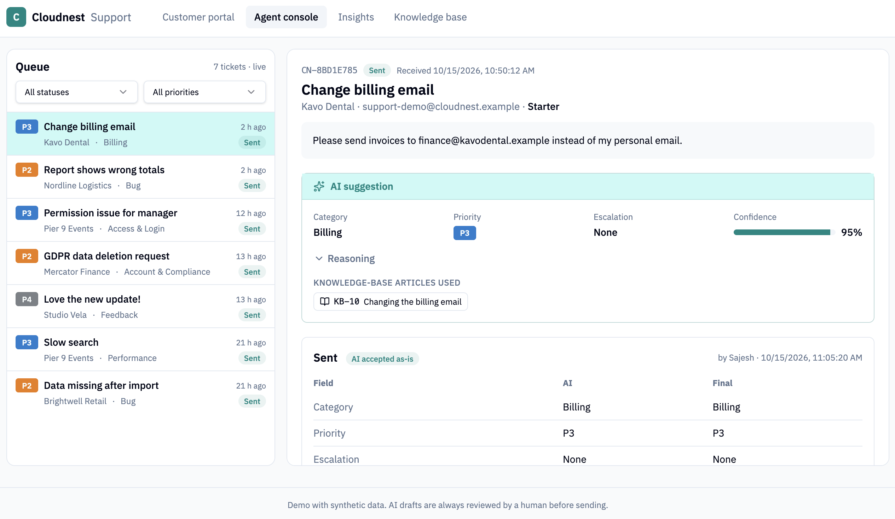

# AI Support Ticket Triage

A working proof of concept: AI triages incoming support tickets, and a support engineer reviews, corrects and approves every reply before it is sent.

Built with **Lovable** (support portal), **n8n** (workflow) and **Claude** (AI). Demo project with synthetic data for a fictional SaaS company, "Cloudnest".

> 🎥 **[Watch the 4-minute demo on YouTube](https://youtu.be/NAt9LSVuf40)**



## The problem

In a busy support team, engineers spend a large share of their time reading, sorting and routing tickets before any real work starts. Urgent issues (outages, security incidents) sit in the same queue as "how do I export to Excel?", and first replies are slow and inconsistent.

## The solution

1. A customer submits a ticket in the portal.
2. The AI classifies it into one of **11 categories** and a **priority from P1 to P4**.
3. It finds the relevant **help articles** and drafts a reply based **only** on those articles.
4. It suggests **escalation** to Engineering, Security, Billing or Account, with a confidence score.
5. P1 and security tickets **alert the team** straight away.
6. A support engineer reviews the suggestion, corrects the category, priority or reply where needed, and approves it. **Nothing is sent without human approval.**
7. Every correction is recorded with a reason, and the **Insights** page shows how often the AI was right.
8. A **Knowledge base** page lists every help article the AI may use, so the engineer can check each suggestion against its source.

## Architecture

```
Customer portal (Lovable)
   │  ticket saved in the database
   ▼
Backend function "triage-ticket" (Lovable Cloud)
   │  POST ticket + help articles, with a shared secret header
   ▼
n8n workflow ──► Claude API (Haiku)
   │  validated JSON: category, priority, articles, escalation, confidence, draft reply
   │  P1 / Security ──► team alert
   ▼
Backend function saves the result ──► Agent console updates live (Realtime)
   ▼
Support engineer reviews, corrects and approves ──► corrections feed the Insights page
```

Design choices:
- **n8n never touches the database.** It receives the ticket, returns the AI result, and the portal saves it. No database keys leave the portal.
- **Only the portal can call the workflow:** the webhook requires a shared secret header.
- **The AI output is validated** before it is saved: unknown categories, priorities or teams are replaced with safe defaults, and the confidence is lowered so the engineer reviews it carefully.
- **Model choice:** Claude Haiku is fast and cheap enough for triage at a fraction of a cent per ticket.

## Results

_Measured on the 30 sample tickets in `data/tickets.csv`, which have expected labels._

| Metric | Result |
|---|---|
| Category matches expected label | _x / 30_ |
| Priority matches expected label | _x / 30_ |
| Reply sent without edits | _x %_ |
| Average AI confidence | _x_ |
| Median time from ticket to approved reply | _x min_ |

What I learned and changed along the way is in [`docs/prompt-changelog.md`](docs/prompt-changelog.md).

## Responsible AI

- **Human in the loop:** the AI only drafts; an engineer approves every reply.
- **Grounded answers:** replies may only use the approved help articles, and each suggestion names the articles it used, which the engineer can open on the Knowledge base page. If the articles don't cover the question, the reply says a specialist will follow up.
- **Low confidence is flagged:** below 0.7 the console shows a warning to review carefully.
- **Feedback loop:** every correction is recorded with a reason, which drives prompt improvements.
- **Data protection:** synthetic data only. In production, personal data would need a data processing agreement and GDPR-compliant handling.
- **Transparency:** under the EU AI Act, customers should be told when a reply was drafted with AI.

## What I would add for production

- Authentication and roles for engineers
- Connection to a real helpdesk or mailbox (for example Zendesk, Freshdesk or Gmail)
- Searching the knowledge base (RAG) instead of sending all articles in each request
- Monitoring of cost, latency and accuracy over time

## Repository

| Folder | Content |
|---|---|
| `data/` | 30 synthetic tickets with expected category and priority |
| `knowledge-base/` | 22 fictional help articles |
| `prompts/` | The triage prompt and the Lovable build prompt |
| `supabase/` | Seed data for help articles and sample tickets |
| `workflow/` | The n8n workflow, ready to import (contains no keys) |
| `docs/` | n8n setup guide, test request, prompt changelog, screenshots |

## Run it yourself

1. Build the portal in Lovable with [`prompts/lovable-prompt.md`](prompts/lovable-prompt.md) and run [`supabase/seed.sql`](supabase/seed.sql).
2. Import [`workflow/triage-workflow.json`](workflow/triage-workflow.json) into n8n and follow [`docs/n8n-workflow-guide.md`](docs/n8n-workflow-guide.md).
3. Give the portal the webhook URL and the shared secret, then click **Simulate incoming ticket**.

## About me

Sajesh Sankaranarayanan: 8 years at Databricks in technical support engineering and support operations management, now working on AI consulting and integration. This project automates the kind of triage work I managed for years.
